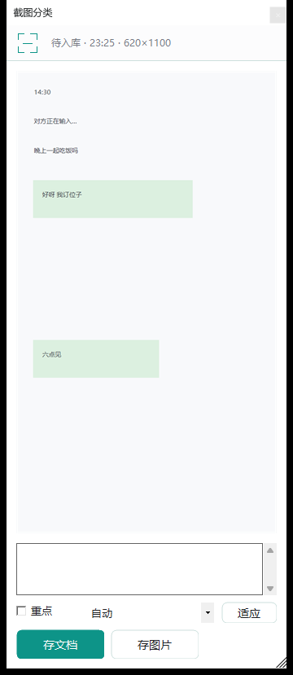
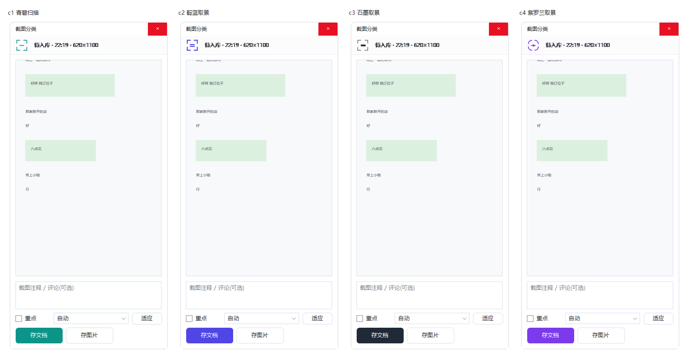

# dsh-screenshot-classify · 截图即存 · 自动分类

DeepSeek Harness 插件：截屏即存，并**按内容自动打类目标签**、给文档截图**写一句摘要**。

监听剪贴板 → 鼠标位置弹出系统级悬浮窗【注释框 +「重点」+ **类目下拉** + 存文档 / 存图片】
→ 图片入库 + 用**宿主自己的多模态大模型**做 OCR（零配置，不用另申请 key）
→ 等 OCR 出文字后，用**本地规则**判断这张图是什么内容，把类目写进笔记标题
→ `#文档` 类再按识别出来的文字写一句摘要 → Obsidian 按天合并
→ 晚间整理时，入库时判好的类目会一路带到知识库文件夹。

A DSH plugin that turns a screenshot into a **classified** Obsidian note: a floating window next to
your mouse (comment / key point / **category picker** / save-as-document or save-as-image), instant OCR
through the host's own multimodal model, **local rule-based classification** into 18 categories, and a
**one-line summary** for document-type captures.

> 这是 [`dsh-screenshot-capture`](https://github.com/passing11/dsh-screenshot-capture) 的分支重写版：
> 采集链路原样保留，新增了分类与摘要。**两者不能同时启用**（同一个剪贴板会被监听两次，弹两个窗）。

---

## 和原插件的区别

| | dsh-screenshot-capture | dsh-screenshot-classify |
|---|---|---|
| 截图入库 / 悬浮窗 / OCR / 晚间整理 | ✅ | ✅ 原样保留 |
| 笔记标题 | `## 14:30 #文档` | `## 14:30 #文档 #学习资料` |
| 判不准时 | — | 额外一行 `> 分类: 梗图表情包（弱）` |
| 文档摘要 | — | `> 摘要: 一道一元一次方程题，要求解出 x。` |
| 弹窗 | 注释 + 重点 + 两键 | 多一个**类目下拉**（默认「自动」） |
| 晚间整理 | 手动指定分类 | 不指定就**沿用入库时判的类目** |
| 配置 | — | 全部沿用原插件那份（`dsh-screenshot-capture` 命名空间） |

---

## 界面

副屏实拍（`PrintWindow` 抓的真实像素，不是效果图）：



四套主题只换配色与头部图标画法，布局和操作完全一致：



> 主题对比图是 GDI+ 离屏绘制的（所以没有系统标题栏），真机长什么样看上面那张。

---

## 功能

- **Windows 系统级悬浮窗**：检测到新截图（或复制图片）后，在鼠标旁弹出置顶小窗。
- **现代扁平界面**（0.2.0 / 0.3.0）：白底、圆角自绘按钮、浅色标题栏、雅黑 UI 字体、按 DPI 缩放。
  窗口标题「截图分类」，窗内顶部是一条 44px 信息条（`待入库 · 22:19 · 620×1100`），不再重复标题。
  四套主题（青碧扫描 / 靛蓝取景 / 石墨取景 / 紫罗兰取景）在设置页一键切换；配色固定，不跟随系统深浅主题。
- **快捷键**：`1` 存文档 / `2` 存图片 / `Esc` 忽略。走 `ProcessCmdKey`，焦点在注释框或
  下拉里也照样生效。
- **注释 / 重点标记**：勾重点后该条以 `# **重点**` 写入笔记。
- **类目下拉**：默认「自动」——等 OCR 出来按内容判；也可以当场指定一个类目，此时跳过规则判定。
  下拉夹在「重点」复选框与「适应」按钮之间的空隙里，不额外占窗口高度。
- **存文档**：图片入库 + 立即占位写入笔记（**绝不让截图丢失**）→ OCR → 分类 → 摘要 → 回填。
- **存图片**：不跑 OCR，只入库 + 尽量判断类目（没有文字时多半判不准，会挂弱标记）。
- **自动分类**：18 个类目，纯本地规则，免费、瞬时、离线。详见下面「分类怎么判」。
- **文档摘要**：`rules`（本地抽取，免费）或 `host`（宿主文本模型写一句人话），默认 `rules`。
- **助手自愈**：剪贴板助手意外退出时按退避自动重启（2s→30s，最多 5 次）并告警。
- **同一屏去重**：按 32×32 灰度指纹比对，`dupWindowMs` 内近似同屏只弹一次窗、只存一条。
- **回填不丢字**：笔记被同步盘 / Obsidian 占用时退避重试并改走「临时文件 + 原子替换」，
  两次仍失败会把结果暂存到 `%TEMP%\dsh-capture\pending-ocr.jsonl` 并告警。
- **晚间整理**：点选保留 / 保存全部 → 归类 → 分类笔记 + 双链 → 当日总结 → 归档。
- **Web 配置界面**：DSH 设置 →「截图分类」。

---

## 环境要求

- **Windows**（依赖系统自带 PowerShell 5.1 + WinForms）
- **DSH 0.1.7 ~ 0.2.x**（设置页依赖 `configForms`；更早的 DSH 上采集照用、设置页不出现）
- **宿主大模型 OCR**：需要 DSH 已加载 `llm` + `attachments` 服务，且候选模型在目录里声明了
  `inputModalities: [text, image]`。不满足就报错并列出试过的候选，**不再有外部回落**
- Obsidian 库（或任意本地 markdown 目录）

---

## 安装

```bash
# 方式一：直接从 GitHub 装（推荐）
dsh plugin --profile desktop add github:passing11/dsh-screenshot-classify

# 方式二：本地目录（开发用，改源码即生效）
dsh plugin --profile desktop add /path/to/dsh-screenshot-classify

# 方式三：打包后再装
npm pack
dsh plugin --profile desktop add ./dsh-screenshot-classify-0.3.1.tgz
```

装完**重启 DSH**（不是刷新页面），然后：

1. DSH 设置 →「截图分类」→ 填 Obsidian 库路径。
2. **停用原插件** `dsh-screenshot-capture`（设置 → 插件，或 `dsh plugin --profile desktop remove dsh-screenshot-capture`）。
   不停用的话两个插件会各弹一个窗、同一张图入库两次。
3. 截一张图试试。

> 旧配置不用重填：本插件会读 `dsh-screenshot-capture` 那份设置作为兜底，
> `vaultPath` / `ocrMode` / 弹窗位置等全部沿用。

---

## 配置项

设置页分组：**模型** / **常规** / **OCR** / **分类** / **摘要** / **弹窗** / **归档**。

| 键 | 默认 | 说明 |
|---|---|---|
| **`modelPrimary`** | `""` | OCR 主模型槽位，写 `provider/model` 或裸 model id |
| **`modelFallback1`** | `""` | 备选 1，主模型失败才试 |
| **`modelFallback2`** | `""` | 备选 2，备选 1 也失败才试 |
| `enabled` | `true` | 总开关 |
| `vaultPath` | `""` | Obsidian 库根目录（必填，空则采集停用） |
| `inboxFolder` | `收件箱` | 每日笔记目录 |
| `attachmentsFolder` | `attachments` | 图片目录 |
| `knowledgeFolder` | `知识库` | 晚间整理后的分类笔记 |
| `summaryFolder` | `总结` | 当日总结 |
| `archiveFolder` | `归档` | 归档后的每日笔记 |
| `ocrMode` | `host` | `host` / `off` |
| `ocrHostModel` | `""` | 只在三个槽位全空时才有意义：留空自动挑声明了图片模态的模型 |
| **`classifyEnabled`** | `true` | 自动分类总开关。关掉＝退回原插件行为 |
| **`classifyMinConfidence`** | `0.55` | 低于它算「判不准」，加弱标记 |
| **`summarizeMode`** | `rules` | `off` / `rules` / `host` |
| **`summarizeHostModel`** | `""` | `host` 模式用哪个模型，留空跟随主模型槽位 |
| **`summarizeMaxChars`** | `120` | 摘要长度上限（20~500） |
| **`dialogTheme`** | `c1` | `c1` 青碧扫描 / `c2` 靛蓝取景 / `c3` 石墨取景 / `c4` 紫罗兰取景 |
| `dialogPositionMode` | `cursor` | `cursor` / `fixed` / `remember` |
| `dialogAutoCloseSec` | `0` | 0＝不自动关 |
| `tagInFilename` / `moveMode` / `unknownCategory` | — | 归档相关，与原插件一致 |

配置文件也可手写：`%USERPROFILE%\.dsh-screenshot-classify\config.json`，
字段见 [`config.example.json`](config.example.json)。

---

## 模型槽位

设置页最上方是一组「模型」选择器，对应三个槽位 `modelPrimary` / `modelFallback1` / `modelFallback2`。

**怎么填**：写 `provider/model`（如 `deepseek-account/deepseek-v4.1-flash`），或者只写裸 model id
（此时用宿主默认 provider 补齐；同一 id 在多个 provider 下重名时会被判重成一条，写全 `provider/model` 更稳）。

**怎么试**：OCR 按 主模型 → 备选 1 → 备选 2 的顺序试，**前一个成功就不再试后面的**；
前一个失败才继续。重复的路由（同一个 `provider/model` 出现两次）**保留先出现的**，后出现的忽略。

**留空**：留空 = 该槽位不参与。三个都留空时退回 0.3.x 的自动选路
（`ocrHostModel` → 宿主当前默认模型 → 目录里第一个声明图片输入的模型），升级后行为不变。

**图片能力**：选择器里没有声明图片输入的模型仍然**可选**，只是带一行「（无图片输入）」；
元数据查不到的带「（图片能力未知）」。真正调用时，目录**明确说**不支持图片的候选会被跳过
（记 `no-image-support`），查不到的不拦（否则所有没写 `inputModalities` 的老适配器一起废掉）。

**测试**：分组下方的「测试主模型」按钮只测当前选中的 `modelPrimary`，发一次 `maxTokens: 8`、
不带图的最小请求。结果写在按钮下面独立一行（绿色 `连通 · Nms` / 红色 `失败:…`），
不会被 4 秒就消失的保存提示盖掉。

**模型目录从哪来**：插件向宿主 llm 服务要 provider / model 列表，只读、不缓存。
目录取不到时选择器是空的，分组下方会显示红字说明原因，其余设置照常可用。

---

## 只读端点

设置页用两个 GET 端点（由宿主 `webServer` 服务注册；该服务不存在时这两个端点不注册，插件其余功能不受影响）：

| 端点 | 说明 |
|---|---|
| `GET /plugins/dsh-screenshot-classify/models` | 模型目录：`{ providers: [{ id, name, models: [{ id, name, supportsImage, imageUnknown, efforts, defaultEffort }] }] }` |
| `GET /plugins/dsh-screenshot-classify/probe?provider=X&model=Y` | 连通性探针：`{ ok, ms, error? }` |

两个端点**恒回 HTTP 200**：服务异常 / 参数缺失都放在响应体的 `error` 字段里
（只有一个例外：非 GET 请求回 405）。这样设置页永远拿得到 JSON，不会因为一次上游抖动
在控制台里刷一个 500。探针是一次真实的最小请求，点一次花一次调用。

---

## 分类怎么判

### 笔记长什么样

```markdown
## 14:30 #文档 #学习资料


> OCR: 测试题目: 3x + 2 = 8,解得 x = 2
> 分类: 学习资料（弱）
> 摘要: 一道一元一次方程题,要求解出 x。

今天上课随手拍的。
```

- 标题行第二个 `#标签` 就是类目 —— 在 Obsidian 里点它能直接筛出这一类。
- 弱判定**不动标题行**，只在 OCR 下面加一行 `> 分类: …（弱）`。
  这样「标签检索」永远干净，而「这条别太信」的信息也不丢。
- 摘要跟在分类行后面，晚间整理时单独成 `## 摘要` 一节。
- **OCR 是多行块引用**：识别的文字每一行都带 `> `，空行写成裸 `>`，整段是 Obsidian 里的**一个**引用块。
  （0.3.x 只写一行 `> OCR: …`，文字里的换行会让第二行起变成普通正文，回填时也会被当成用户注释。）

### 18 个类目

聊天记录 / 支付账单 / 购物 / 游戏截图 / 问答社区 / 社交媒体 / 视频播放 / 学习资料 /
文档票据 / 交友社交 / 地图出行 / 代码开发 / 二次元 / 梗图表情包 / 时政新闻 / 生活日常 /
文字梗 / 摄影

`文字梗` 是诚实兜底：**有文字、但推不出更具体场景**的图都进这里（段子、神回复、长文分享、
网友评论截图）。这类图既不是「梗图」（没夸张图画）也不是「生活日常」，硬塞进哪个都是撒谎。

### 打分（和 dsh-photo-organizer 同一套）

| 线索 | 权重 |
|---|---|
| App 包名（`com.tencent.mm` 等 35 个） | 4.0 |
| 特征短语命中 1 个 | `min(raw,1.2) × 0.35`，**不记理由** |
| 特征短语命中 ≥2 个不同词 | `raw + 0.8 + 0.35 × min(hits-2,4)` |
| 正则（如「据…报道」） | 2.0 |
| 竖屏截图形态 | 7 个截图类各 +0.5 |
| 文字 > 400 字 | 4 个文档类各 +0.4 |
| 文字 < 40 字 | **只给**「梗图表情包」+0.7 |
| 相机直出 | 摄影 2.2（有字）/ 2.5（无字） |
| 米哈游系包名 | 游戏截图 3.0 |

### 证据强度（比置信度更值得看）

分数高不等于判得准。每条判定都带一个 `evidence`：

| `evidence` | 含义 | 置信度 | 能不能信 |
|---|---|---|---|
| `strong` | 包名 / 正则 / ≥2 个关键词 | 0.5~1.0 | 可以信 |
| `camera` | 相机直出 | 0.8 | 可以信 |
| `weak` | 只有形态学（文字长短之类） | 0.3~0.4 | **这是猜** |
| `fallback` | 一条规则都没命中 | 0.2 | 承认推不出来 |
| `manual` | 弹窗里人工指定 | 1.0 | 你说的算 |

置信度也按证据给，不按分数给：`weak` 一律压到 0.3~0.4，`fallback` 固定 0.2。
这样「判不准」在笔记里看得见，而不是假装很确定。

### 四条踩过的坑（别再犯）

1. **不要写裸的时间正则。** `\d{1,2}[：:]\d{2}` 看着无害，但手机截图状态栏右上角永远有
   「16:12」，OCR 一定读出来 —— 实测单独命中 922 张，把「生活日常」顶到 21%。要时间线索，
   必须带上「人怎么用它」的上下文。
2. **形态学不能选类目。** 早先「文字 < 40 字」同时给「梗图表情包」和「二次元」各 +0.7，
   982 张的冠军由类目表**声明顺序**决定 —— 等于用「字少」宣布「这是动漫」。
3. **目录先验不能对有文字的图生效。** 「从 B 站存的图」回答不了「画面画的是什么」。
   降权到 0.4 也没用：那些图往往一条文本规则都不命中，0.4 照样独赢（实测 2310 张全判二次元）。
   本插件干脆不用目录——截图落在哪个目录跟画面无关。
4. **无文字不能平均分给三个类目。** 早先「没文字 → 摄影/二次元/梗图各 +1.4」，冠军又由声明顺序
   决定，无文字截图会莫名变成「摄影」。现在没文字就承认没证据，走兜底或由真线索接手。

---

## 摘要（可选）

| 模式 | 做什么 | 花钱 |
|---|---|---|
| `off` | 不写摘要 | 0 |
| `rules`（默认） | 本地抽取式：从 OCR 文字里挑信息量最大的那句 | 0 |
| `host` | 把 OCR 文字交给宿主文本模型，让它写一句人话 | 很少（只喂文字，不喂图片） |

- 摘要**永不抛错**：模型挂了就降级到 `rules` 并打一条 warn，不影响截图分类。
- 只对 `#文档` 做。`#图片` 不跑 OCR，没有文字可总结。
- OCR 失败（笔记里写的是 `（识别失败:…）`）时跳过 —— 那串字不值得总结。

---

## Obsidian 结构

```
<vault>/
├── 收件箱/2026-11-13.md          # 当天所有截图,按时间块合并
├── attachments/                   # 图片
├── 知识库/
│   ├── 学习资料/
│   │   ├── 20261113_1430_文档.md
│   │   └── INDEX.md
│   └── …
├── 总结/2026-11-13.md             # 当日总结(链接全部保留条目)
└── 归档/2026-11-13.md             # 整理后的收件箱笔记
```

晚间整理时，类目优先级：**当晚手动指定 > 入库时判定的 > 未分类**。
也就是说入库时判好的类目会一路带到知识库文件夹，不会被抹平成「未分类」。

---

## 工具

| 工具 | 作用 |
|---|---|
| `screenshot_status` | 状态：监听是否运行、vault 路径、今天收了几条 |
| `screenshot_inbox_list` | 列出某天收件箱里的条目（时间 / 类型 / 类目 / OCR / 摘要） |
| `screenshot_inbox_organize` | 晚间整理：保留指定条目 → 知识库 + 索引 + 总结 + 归档 |

典型流程：

```text
screenshot_inbox_list              # 看今天有什么
screenshot_inbox_organize keep=["14:30","14:32"]   # 保留这两条
```

---

## 开发与测试

不需要 DSH 也能跑（`node_modules` 里的 `@deepseek-ai/*` 只在装进 DSH 时才需要）：

```bash
npm test                  # 9 个 JS 套件：format/storage/reasoning/autoclose/config-shape/
                          #               single-instance/settings-reload/classify/summarize
npm run test:window       # 悬浮窗自动关闭
npm run test:window:layout# 悬浮窗布局（含类目下拉的位置断言）
npm run test:window:keys  # 快捷键 1/2（14 项，反射调 ProcessCmdKey）
npm run test:window:category  # 类目回传（12 项，真选中 + 真点按钮）
npm run test:classify     # 分类规则（48 项）
npm run test:summarize    # 摘要（46 项）
```

PowerShell 套件共 11 个、**338 项断言**，跑法：

```powershell
Get-ChildItem test\test-*.ps1 | ForEach-Object {
  powershell -NoProfile -ExecutionPolicy Bypass -STA -File $_.FullName
}
```

> **这些测试会真的弹出窗口**。模拟指针优先挑一块非主屏，只有一块屏时才退回主屏 ——
> 你正在用的那块屏不该被测试弹窗打断。测试期间窗口会短暂出现在副屏上，几秒后自己关掉。
>
> 必须 `-STA`：WinForms 弹窗在 MTA 下起不来。
>
> `test-dialog-keys.ps1` 不用 `SendKeys` —— 在后台/无交互桌面上它根本不返回，测试会
> 挂死。改为直接反射调 `DscFastForm.ProcessCmdKey`，绕过的是「键怎么从桌面走到窗体」
> 那一段（那是 Windows 的职责），我们自己的分支逻辑照样被完整执行。

> `test-single-instance` 需要往 `~/.dsh/dsh-screenshot-capture/` 写锁文件。
> 在受限沙箱里会 **跳过并说明原因**，而不是把「环境不允许」报成「锁坏了」。

---

## 安全说明

- 图片与文字**只在本机**流转。OCR 走宿主大模型时，图片会发给你当前配置的模型提供方；
  介意的话把 `ocrMode` 设成 `off`（那就没有文字可分类，只剩 `#图片`）。
- 摘要同理：`rules` 完全本地，`host` 会把 OCR 文字发出去。
- 弹窗传来的类目字符串**先过白名单**才采信 —— 它最终会变成笔记标题里的 `#标签`，
  不认识的类目当没指定处理。

## License

MIT
